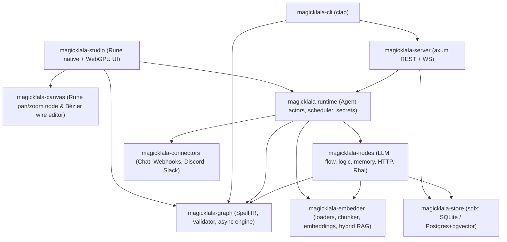

# MagickLaLa — Rust + Rune Architecture & Implementation Plan

**MagickLaLa** is a **100% Rust** visual AI agent and workflow development environment (AIDE), built around a fast single-binary architecture and a native GPU-rendered Studio powered by [Rune](https://github.com/anomalyco/rune).

---

## 1. Design Goals

| Area | MagickLaLa (100% Rust + Rune) |
| :--- | :--- |
| **Runtime & Packaging** | Single Cargo workspace compiling into one cohesive binary (`magicklala`) with modular crates; optional distributed worker mode later |
| **Graph Engine** | Pure Rust async dual-socket graph engine (`magicklala-graph`), shared directly by the engine, CLI, and Rune Studio with zero schema drift |
| **Visual Studio (IDE)** | **Rune** native GPU UI (`wgpu`) on macOS, Windows, Linux, and optional WebGPU browser build (`crates/magicklala-studio` + `crates/magicklala-canvas`) |
| **Database & Vectors** | `sqlx` repository traits: **SQLite** by default for zero-config local startup, **PostgreSQL + `pgvector`** for production scale |
| **Agent Orchestration** | In-process Tokio actor runtime (`magicklala-runtime`) with pluggable event bus trait (in-memory default, Redis/NATS later) |
| **Custom Code & Plugins** | Sandboxed **Rhai** script nodes + trait-based Rust plugins, expanding to **WASM Component Model (`wasmtime`)** external plugins |
| **UI Verification** | Rune headless runtime (`Runtime::new`, scripted pointer/drag events, `--snap` PNG captures) for deterministic visual & interaction tests |

---

## 2. Core Domain Model

- **Spell**: A JSON-serializable directed graph of **Nodes**, **Sockets** (typed Value sockets + imperative Flow/Trigger sockets), **Wires**, **Variables**, and nested **Subgraphs**.
- **Spell Release**: An immutable snapshot of one or more Spells pinned to an Agent so live runs never break during editing.
- **Agent**: An autonomous runtime instance bound to a Spell Release, owning encrypted **Credentials**, persistent **State**, **Channels**, **Memories** (episodic + vector), and **Knowledge** (ingested documents / RAG).
- **Event & Connector**: Inbound events (`on_message`, `on_webhook`, `on_tick`, `on_memory`, `on_variable_changed`) trigger Spell execution; outbound actions (`send_message`, `stream_message`, HTTP calls) flow back through connectors.
- **Execution Trace**: Live structured telemetry (`NodeStarted`, `WireActivated`, `NodeOutput`, `NodeError`, token/cost metrics) streamed directly into the Rune Studio canvas.

---

## 3. Cargo Workspace Architecture

### Crate Responsibilities

1. **`crates/magicklala-graph`** — *Pure Rust Spell Engine (Zero-I/O)*
   - Graph IR (`SpellGraph`, `NodeInstance`, `SocketSpec`, `Wire`, `VariableDef`, `SubgraphRef`) with clean MagickLaLa JSON schema.
   - Typed value system: `Flow`, `String`, `Int`, `Float`, `Bool`, `Json`, `Array`, `Embedding`, `Event`, `Any`.
   - Dual-socket async execution engine:
     - **Flow sockets** drive imperative async control flow (`branch`, `switch`, `split`, `wait_for_all`, `while_loop`, `delay`, cancellation, step watchdogs).
     - **Value sockets** resolve lazily via pull evaluation with per-activation memoization.
   - `TraceSink` channel emitting live node/wire activation events for Studio playback and CLI debugging.

2. **`crates/magicklala-nodes`** — *Standard Node Library*
   - **Flow & Lifecycle**: `on_start`, `on_tick`, `branch`, `switch`, `split`, `wait_for_all`, `while_loop`, `do_once`, `delay`.
   - **Events & Messaging**: `on_message`, `on_webhook`, `on_memory`, `on_variable_changed`, `send_message`, `stream_message`, `message_history`.
   - **AI / LLM**: `generate_text`, `stream_text`, `structured_json`, `embedding`, `tool_call` (OpenAI-compatible, Anthropic, Gemini, Ollama/vLLM).
   - **Memory & Knowledge**: `add_memory`, `get_memories`, `clear_memories`, `add_knowledge`, `search_knowledge`, `string_chunker`.
   - **Data & Logic**: `text_template`, `string_replace`, `regex_match`, `json_parse`, `json_stringify`, `destructure`, `validate`, `variable_get`, `variable_set`, `variable_reset`, `http_fetch`.
   - **Sandboxed Script Node**: **Rhai** embedded scripting with user-defined input/output sockets and execution limits.
   - Strongly typed `NodeSpec` registry shared directly with `magicklala-canvas` and exposed over `/api/v1/node-specs`.

3. **`crates/magicklala-store`** — *Persistence & Vector Layer*
   - Entities: `projects`, `agents`, `spells`, `spell_releases`, `credentials` (AES-256-GCM encrypted at rest), `chat_messages`, `memories`, `knowledge_documents`, `knowledge_chunks`, `plugin_state`, `webhooks`, `execution_runs`, `llm_requests`.
   - SQLite default (`magicklala.db`) for zero-dependency single-binary runs; PostgreSQL + `pgvector` for production deployments.

4. **`crates/magicklala-runtime`** — *Agent Supervisor & Runtime*
   - Tokio actor supervisor per running Agent (`AgentSupervisor`) handling hot Spell Release reloads, per-channel ordering, credential decryption, and token/cost metering.
   - Pluggable `EventBus` trait (`InMemoryBus` default; optional Redis/NATS backend in Phase 6).

5. **`crates/magicklala-embedder`** — *Knowledge Ingestion & Hybrid RAG*
   - Loaders for Plaintext, Markdown, JSON, HTML/URL, and PDF.
   - Recursive chunking with configurable overlap + batched embeddings + hybrid vector/FTS retrieval.

6. **`crates/magicklala-connectors`** — *Channels & Plugin SDK*
   - Unified `Connector` trait for HTTP/WS Chat, dynamic Webhooks, Cron/Tick, Discord (`serenity`/`twilight`), and Slack.
   - Phase 5+: WASM Component Model (`wasmtime` + WIT) plugin host for third-party nodes and connectors.

7. **`crates/magicklala-server`** — *Headless API & WebSocket Control Plane (`axum`)*
   - Versioned REST API (`/api/v1/...`) + OpenAPI docs (`utoipa`) + WebSocket streaming (`/ws`) for headless deployments, remote Studio connections, and webhook ingestion.

8. **`crates/magicklala-canvas`** & **`crates/magicklala-studio`** — *Rune Visual IDE*
   - Built on [`anomalyco/rune`](https://github.com/anomalyco/rune) (pinned `dev` rev via git submodule + required `[patch.crates-io]` vendor patches for `wgpu-hal`, `winit`, `sctk-adwaita`, `parley_engine`, `accesskit_windows`, `accesskit_macos`).
   - **`magicklala-canvas`**: Reusable GPU-rendered node-graph editor built on Rune's `canvas(Shape)`, `Path` cubic Bézier wires, `El::absolute`, `on_drag` (`Phase::Down`/move/up), pan/zoom camera, color-coded typed sockets, drag-to-connect validation, right-click `rune-kit` context menu, and animated live execution traces.
   - **`magicklala-studio`**: Full AIDE shell using `rune-kit` + `rune-edit` (prompt/Rhai code editor): Spell board, Node palette, Inspector, Variables panel, Live Chat Playground, Agents & Releases manager, Knowledge uploader, and Credentials vault.
   - Primary target: native macOS/Windows/Linux desktop app (`wgpu`). Secondary target: experimental WebGPU/WASM build via Rune's `web-build.sh`.
   - Verified with Rune headless tests (`Runtime::new` + scripted pointer/drag inputs + `--snap` PNG visual checks).

9. **`crates/magicklala-cli`** — *CLI (`clap`)*
   - `magicklala studio` — Launch the Rune native Studio (with embedded local runtime).
   - `magicklala serve` — Run headless API/agent server.
   - `magicklala spell run|validate|specs` — Execute, check, or inspect Spells from the terminal.
   - `magicklala agent start|stop|logs` — Control agents from CLI.

---

## 4. Phased Implementation Roadmap

Every phase ends with a runnable, tested vertical slice reviewed via PR + CodeRabbit.

### Phase 0 — Repository, Toolchain & Rune Integration Smoke Test
- Initialize Cargo workspace (`edition = "2024"`, Rust `1.99+`), `clippy` / `rustfmt` lints, `tracing`, and CI workflow.
- Pin `anomalyco/rune` as a git submodule (with workspace `[patch.crates-io]` configured) and verify a minimal headless `--snap` PNG smoke test compiles and passes.
- **Exit criterion**: `cargo test --workspace`, `cargo clippy --workspace`, and Rune headless snapshot test pass cleanly.

### Phase 1 — Core Graph Engine, Core Nodes & Headless CLI
- Build `magicklala-graph` (IR, validator, flow/value async executor, subgraphs, variables, `TraceSink`).
- Build Phase 1 `magicklala-nodes` (`on_start`, `branch`, `switch`, `split`, `wait_for_all`, `while_loop`, `delay`, `text_template`, `json_parse/stringify`, `http_fetch`, `generate_text`, `stream_text`, `variable_get/set`, Rhai `script`).
- Build `magicklala-cli` (`spell run`, `spell validate`, `spell specs`) + 3 starter example spells.
- **Exit criterion**: Execute a multi-node AI Spell with parallel branches and streaming output from the CLI with live trace logs.

### Phase 2 — Persistence, Agent Runtime & Axum Control Plane
- Build `magicklala-store` (SQLite + `sqlx` migrations, AES-256-GCM encrypted credentials vault, LLM request metering).
- Build `magicklala-runtime` (`AgentSupervisor`, Spell Releases, conversation history, channel state).
- Build `magicklala-server` (`axum` REST CRUD + WebSocket chat & trace streaming).
- **Exit criterion**: Run `magicklala serve`, deploy an Agent + Spell Release, and chat with streaming responses and persistent memory.

### Phase 3 — MagickLaLa Studio (Rune Visual IDE)
- Build `magicklala-canvas` (pan/zoom, draggable node cards, typed colored sockets, cubic Bézier wires, drag-to-connect, right-click node creation, live trace highlighting).
- Build `magicklala-studio` (Inspector, `rune-edit` prompt/script editor, Variables, Chat Playground, Agents & Releases, Credentials vault) connected directly to `magicklala-runtime` (or remote `magicklala-server`).
- Add Rune headless interaction & `--snap` visual verification tests.
- **Exit criterion**: Author, save, release, run, and visually debug an AI Spell entirely inside the native Rune desktop Studio.

### Phase 4 — Knowledge (RAG) & Vector Memory
- Build `magicklala-embedder` (Markdown/Text/HTML/PDF loaders, chunker, embedding providers).
- Add vector similarity + FTS hybrid search to `magicklala-store` (SQLite local vector search + PostgreSQL `pgvector` backend).
- Wire `add_memory`, `get_memories`, `add_knowledge`, `search_knowledge` nodes and Knowledge UI in Studio.
- **Exit criterion**: Ingest documents, retrieve relevant chunks inside a Spell, and recall long-term episodic memories across chats.

### Phase 5 — Connectors & WASM Plugin Extensibility
- Build `magicklala-connectors`: dynamic Webhooks (`on_webhook`), Cron/Tick (`on_tick`), Discord, and Slack.
- Add Connector management UI in Studio.
- Prototype `wasmtime` / WIT custom node plugin loader.
- **Exit criterion**: Run the same Spell live across Studio Chat, Webhooks, Discord, and Slack.

### Phase 6 — In-Studio Co-Pilot, WebGPU Build & Scale-Out
- Build **MagickLaLa Co-Pilot**: in-Studio AI assistant that generates, explains, and patches Spells through typed graph-mutation tools.
- Enable optional Rune WebGPU browser bundle (`web-build.sh`) + optional Redis/NATS distributed worker mode (`magicklala worker`).
- Add OpenTelemetry export and cross-platform release packaging.
